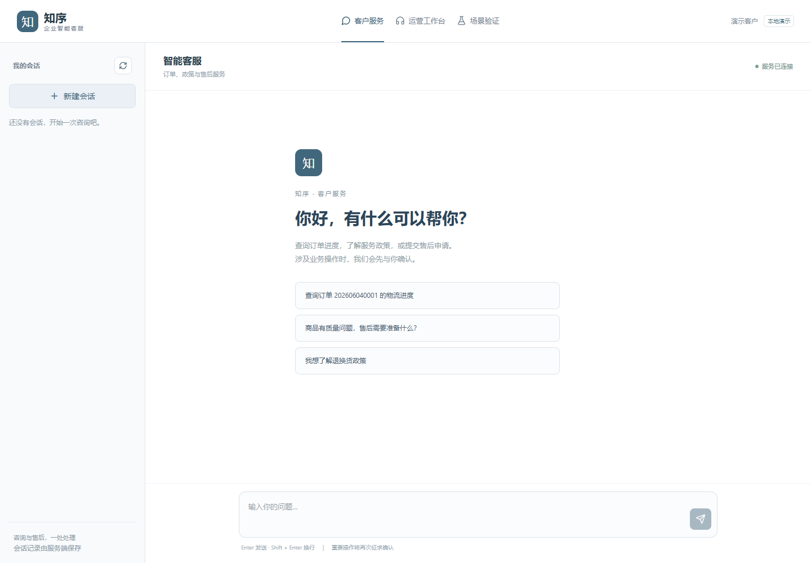
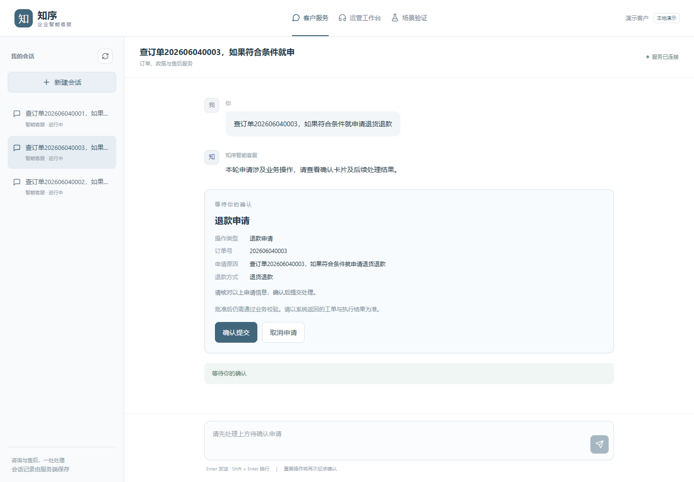
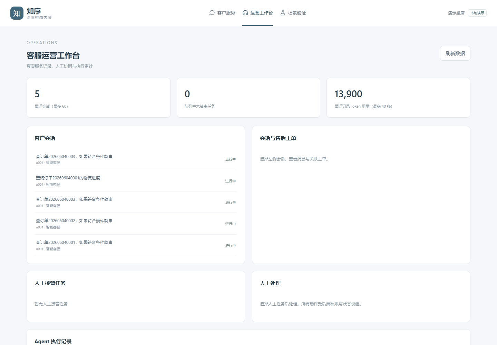
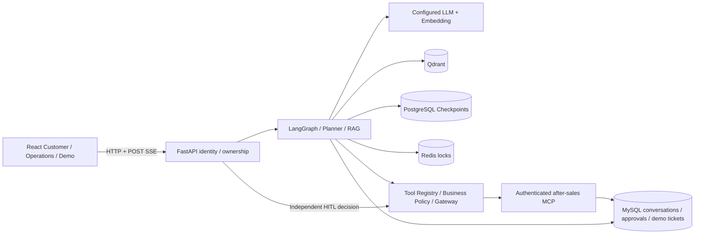

# Enterprise Customer Service Agent

[中文](README_CN.md) · [Documentation](docs/README.md) · [Release checklist](docs/RELEASE_CHECKLIST.md)

A stateful customer-service Agent with a real React product interface, evidence-aware business decisions, explicit approval for sensitive actions, and live LangGraph/SSE interaction. Designed for learning, demonstrations and further integration—not a ready-made payment or production identity system.

## Features

- **Stateful LangGraph workflows:** multi-turn context, bounded planning, tool calls and PostgreSQL checkpoints.
- **RAG:** a versioned demonstration knowledge base; dense Qdrant retrieval by default. OpenSearch/hybrid retrieval, Milvus and reranking are optional integrations.
- **Business-result conditions:** ToolOutcome distinguishes execution success from satisfied business facts; missing or unverified evidence fails closed.
- **MCP integration:** an independent after-sales service with service authentication, signed approval arguments and stable operation IDs.
- **Human-in-the-Loop:** customer approval/rejection, fresh fact checks, human handoff and an operations workspace.
- **Reliable writes:** idempotency and operation reconciliation; approval or a dropped connection is never treated as proof of success.
- **Real streaming:** completed Graph nodes, tool lifecycle and provider-native final-synthesis deltas. No simulated token splitting.
- **Product UI:** customer chat/history/citations/approval cards, operations records and a separate Demo Lab.

## Product screenshots

Captured from the actual isolated seeded demo; no real customer transcripts or credentials. The interface currently uses Chinese.



| Approval | Operations |
| --- | --- |
|  |  |

[SSE progress](docs/images/sse-progress.png) · [Demo Lab](docs/images/demo-lab.png) · [Blocked order](docs/images/scenario-shipped.png) · [Missing evidence](docs/images/scenario-evidence.png) · [Created demo ticket](docs/images/scenario-approved.png)

## Architecture



[Component/trust-boundary details](docs/ARCHITECTURE.md) · [Streaming contract and lifecycle](P4.2真实流式交互与验收.md)

## Tech stack

Python 3.11, FastAPI, Pydantic, SQLAlchemy/Alembic, LangGraph, MCP **1.x**, OpenAI-compatible APIs, MySQL, PostgreSQL, Redis and Qdrant **1.18**. Frontend: React, TypeScript, Vite, Tailwind and React Router. Python versions are pinned in `requirements.lock` and `constraints.txt`; Node packages use `frontend/package-lock.json`.

## Quick start: full local demo

Prerequisites: Git, Python **3.11**, Docker Engine/Desktop running Linux containers, and Docker Compose v2. Host Node is only needed for frontend development; Docker builds the frontend itself.

Clone the repository URL supplied by its publisher, then run from its root:

```bash
python3.11 -m venv .venv
.venv/bin/python -m pip install -r requirements.lock
cp .env.demo.example .env
# Edit .env: provide chat and embedding endpoints, models and API keys.
.venv/bin/python scripts/run_full.py
```

Windows PowerShell:

```powershell
py -3.11 -m venv .venv
.\.venv\Scripts\python.exe -m pip install -r requirements.lock
Copy-Item .env.demo.example .env
# Fill the provider settings in .env, then:
.\.venv\Scripts\python.exe scripts/run_full.py
```

The launcher generates a private `.env.full` with dedicated database/signing credentials, builds both images, migrates and seeds MySQL, ingests knowledge using your embedding provider, and starts the isolated stack. Provider calls may consume quota. It does not run paid acceptance suites automatically.

| Interface | URL |
| --- | --- |
| Customer Chat | http://127.0.0.1:8002/chat |
| Operations | http://127.0.0.1:8002/operations |
| Demo Lab | http://127.0.0.1:8002/demo |
| Legacy validation console | http://127.0.0.1:8002/ops |

Windows users can subsequently use `start-full.cmd`. No global Python/npm installation is required beyond the prerequisite runtimes.

## Environment configuration

Start with the small [demo template](.env.demo.example); the full [reference template](.env.example) documents advanced settings. Fill `LLM_API_KEY`, `LLM_BASE_URL`, `LLM_MODEL`, `EMBEDDING_API_KEY`, `EMBEDDING_BASE_URL`, `EMBEDDING_MODEL` and the embedding dimension supported by your provider. The sample model must be available to your own account; it is not a free-quota promise.

Never commit generated `.env*` credentials. Database/checkpoint volumes and credentials must stay paired. The default stack is a **trusted local demo**, bound to loopback, with explicit demo identities. Production must enable backend authentication and external identity/SSO; do not expose `SECURITY_ENABLED=false` publicly.

[Independent stacks, restart and volume handling](docs/DEPLOYMENT.md) · [Local SQLite/frontend development](docs/DEVELOPMENT.md) · [Security](SECURITY.md)

## Demo scenarios

Use the same question pattern: `查订单<order-id>，如果符合条件就申请退货退款`.

| Seeded order | Facts | Expected result |
| --- | --- | --- |
| `202606040001` | Shipped | Blocks automatic refund application; no approval or ticket |
| `202606040002` | Delivered, insufficient reviewed evidence | Explains missing verification; no automatic submission |
| `202606040003` | Delivered, valid demo pre-review | Requires customer confirmation; approval creates one MCP application ticket |

These fixtures come from `scripts/seed_sample_data.py`. Rejection creates no ticket; repeat approval must not create a second one. They demonstrate **refund applications, not payment refunds**, actual evidence/video verification or complete merchant/legal eligibility rules.

## Development and testing

```bash
python -m pytest -q
python -m ruff check --select E4,E7,E9,F src tests scripts mcp_services/after_sales_server/src
python scripts/check_dependencies.py
python scripts/check_openapi.py
npm ci --prefix frontend
npm run typecheck --prefix frontend
npm test --prefix frontend
npm run build --prefix frontend
```

Use the virtual environment's Python (or activate it first). Frontend development: `npm run dev --prefix frontend`; Vite proxies to port 8002, configurable with server-side `BACKEND_URL`. See [frontend instructions](frontend/README.md).

Default CI performs offline/mock tests, migration checks, frontend checks, generated-type consistency, image builds and redacted secret scans. It does **not** call paid LLM APIs or create MCP tickets. Real-provider acceptance is a separate manually dispatched workflow with an explicit cost confirmation and an isolated stack.

Actual local/Linux/build/rehearsal evidence and limitations are recorded in [the release checklist](docs/RELEASE_CHECKLIST.md). No hosted CI success badge is shown: this source directory has not been published or run on GitHub Actions.

## Security and limitations

- No production SSO integration, payment refund integration or automatic evidence verification.
- No persistent SSE event log or exact event replay. Recovery re-reads owned persisted state.
- No guarantee that every in-flight task continues after a process crash; unknown outcomes need reconciliation.
- Final tool-result synthesis can stream native text; already-complete direct/cached/conditional answers are not artificially split.
- Default retrieval is dense; optional OpenSearch/reranking and production deployment configurations need their own validation.
- The supplied workspace has no `.git`; upstream tracking/history and provenance must be checked by the publisher. A clean source scan cannot certify missing history.

## Project structure

```text
src/                  Agent backend and shared policy
frontend/             React customer and operations product
mcp_services/         Independent after-sales MCP service
knowledge_base/       Demonstration policies and FAQs
migrations/           Alembic schema migrations
scripts/              Setup, ingestion, validation, release tools
tests/                Offline automated tests
docs/                 Deployment, architecture, screenshots, checklist
.github/workflows/    Offline CI and explicit paid E2E
```

## Roadmap

Current: V3 conditional business execution, product UI, P4.2 streaming and P5 release engineering. Future: production identity integration, proxy/load/failure recovery validation, optional retrieval experiments and—if needed—a persistent event/job mechanism. These are not claimed as completed features.

## License and attribution

[MIT](LICENSE), original copyright **2026 Wang Jinpeng**, preserved unchanged. See [third-party and upstream attribution notes](THIRD_PARTY_NOTICES.md). Confirm the original upstream URL before publishing a fork. Contributions: [CONTRIBUTING.md](CONTRIBUTING.md).
