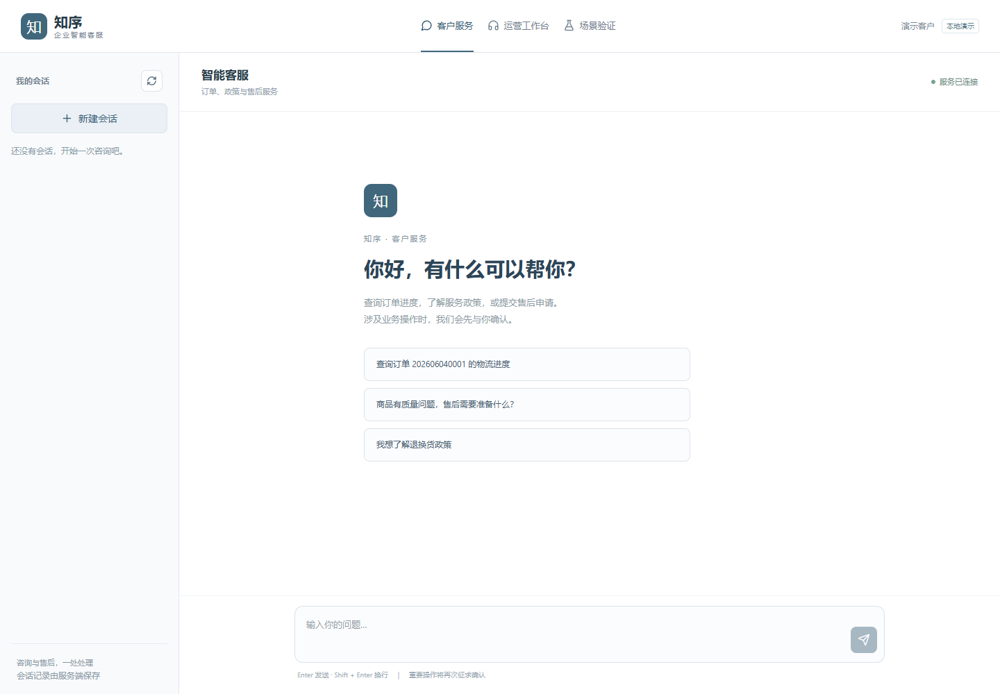
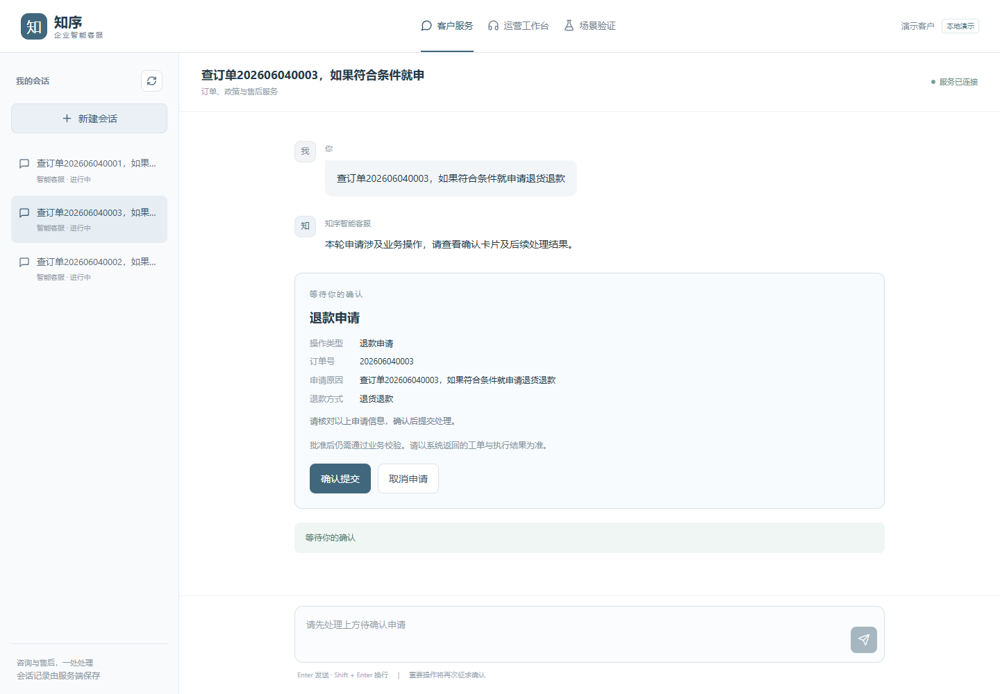
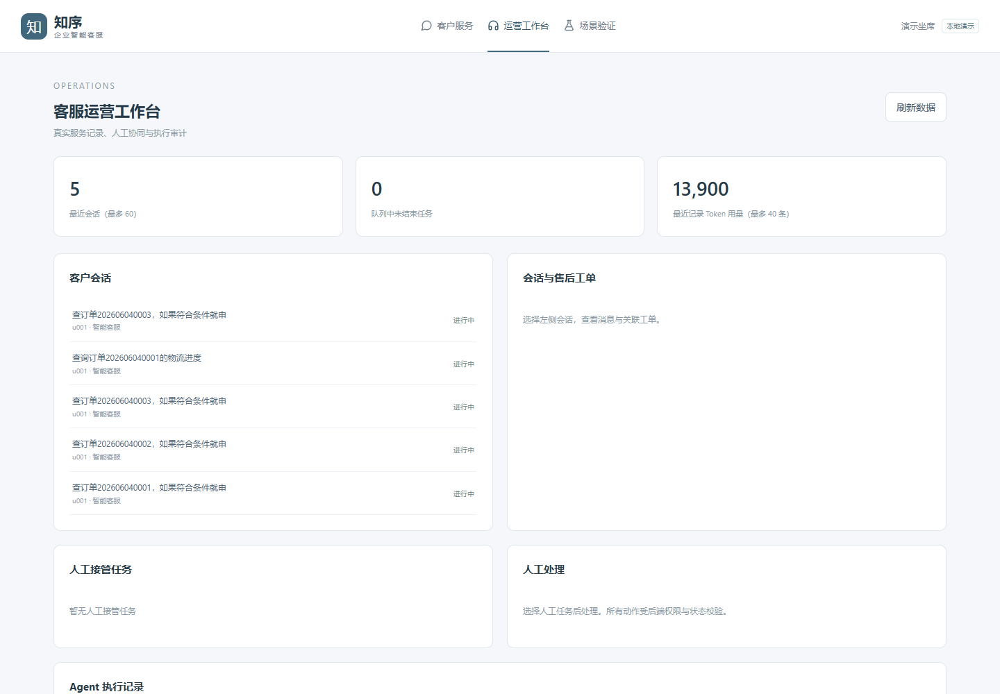

# Enterprise Customer Service Agent

[English](README.md) · [文档导航](docs/README.md) · [发布检查清单](docs/RELEASE_CHECKLIST.md)

一个可运行的企业客服 Agent 演示项目：有状态工作流、知识检索、受控业务工具、用户审批、人工协同，以及真实流式 React 产品界面。适合学习、演示和继续集成；不等于已经具备完整生产支付与身份系统。

## 核心能力

- LangGraph 有状态工作流、多轮上下文、有限 Planner 与 PostgreSQL Checkpoint。
- RAG 知识检索与版本化知识库；默认 Qdrant Dense 检索，OpenSearch/Hybrid、Milvus、Rerank 可选。
- Tool Calling、ToolOutcome 与基于真实业务结果的条件分支；证据未知时保守阻断。
- 独立售后 MCP，服务鉴权、审批参数签名、operation_id 幂等及不确定操作对账。
- HITL 批准/拒绝、实时事实复核、人工接管与客服运营工作台。
- 真正的节点完成事件、工具生命周期及最终汇总答复的模型原生增量；不拆字模拟流。
- React 客户聊天端、会话历史、知识引用、确认卡片、工单结果与独立 Demo Lab。

## 界面截图

以下截图来自独立部署的真实应用，只包含 Seed 演示数据，不是 AI 生成图。



| 用户确认卡片 | 运营工作台 |
| --- | --- |
|  |  |

[真实 SSE 进度](docs/images/sse-progress.png) · [Demo Lab](docs/images/demo-lab.png) · [未签收阻断](docs/images/scenario-shipped.png) · [证据不足](docs/images/scenario-evidence.png) · [演示工单结果](docs/images/scenario-approved.png)

## 架构

React → FastAPI 身份与归属校验 → LangGraph / Planner / RAG → Tool Registry / BusinessPolicy / Gateway → 独立 MCP → 演示工单。MySQL 保存会话/审批/工单，PostgreSQL 保存 checkpoint，Redis 保护会话并发，Qdrant 保存知识向量。敏感操作通过独立审批接口，不能由流式进度自动批准。

完整系统图见 [架构文档](docs/ARCHITECTURE.md)；事件字段与生命周期见 [P4.2 说明](P4.2真实流式交互与验收.md)。

## 技术栈

Python 3.11、FastAPI、Pydantic、SQLAlchemy/Alembic、LangGraph、MCP 1.x、OpenAI-compatible API、MySQL、PostgreSQL、Redis、Qdrant 1.18；前端为 React、TypeScript、Vite、Tailwind、React Router。Python 使用 `requirements.lock` / `constraints.txt`，前端使用 `package-lock.json`。

## 快速启动：完整本地 Demo

准备 Python **3.11**、Git、已启动的 Docker Engine/Desktop（Linux 容器）和 Compose v2。完整 Docker 运行不需要在宿主机安装 Node，只有前端开发需要 Node 24。

从发布者提供的仓库地址克隆，进入根目录。Windows PowerShell：

```powershell
py -3.11 -m venv .venv
.\.venv\Scripts\python.exe -m pip install -r requirements.lock
Copy-Item .env.demo.example .env
# 编辑 .env，填写自己的聊天/Embedding 模型、接口和 API Key。
.\.venv\Scripts\python.exe scripts/run_full.py
```

Linux/macOS：

```bash
python3.11 -m venv .venv
.venv/bin/python -m pip install -r requirements.lock
cp .env.demo.example .env
# 填写提供者配置后：
.venv/bin/python scripts/run_full.py
```

启动器会生成私有 `.env.full` 和项目专用数据库/签名密钥，构建两个镜像，完成迁移、Seed、真实知识入库和服务启动。入库与聊天会使用模型额度；默认启动不会自动执行付费验收或生成验收工单。Windows 后续可双击 `start-full.cmd`。

| 页面 | 地址 |
| --- | --- |
| 客户聊天端 | http://127.0.0.1:8002/chat |
| 客服运营端 | http://127.0.0.1:8002/operations |
| Demo Lab | http://127.0.0.1:8002/demo |
| 兼容验证台 | http://127.0.0.1:8002/ops |

## 环境配置

先使用简短的 [.env.demo.example](.env.demo.example)；[.env.example](.env.example) 是完整配置参考。必须确认自己的服务支持所选模型和 Embedding 维度。示例模型不是免费额度承诺。聊天服务和 Embedding 可以使用不同 Key/接口。

不要提交 `.env`、`.env.full` 或生成的配置。默认是受信任电脑上的本地 Demo，监听 loopback，明确关闭鉴权并提供演示身份。生产部署必须启用后端身份验证并集成外部身份/SSO，不能把 `SECURITY_ENABLED=false` 暴露到公网。

[Docker 部署、独立实例和数据卷](docs/DEPLOYMENT.md) · [前端/SQLite 开发](docs/DEVELOPMENT.md) · [安全说明](SECURITY.md)

## 三个真实业务场景

在聊天端输入 `查订单<订单号>，如果符合条件就申请退货退款`，或进入 Demo Lab。

| 订单 | 演示事实 | 应有结果 |
| --- | --- | --- |
| `202606040001` | shipped，未签收 | 阻断自动申请，无审批、无工单 |
| `202606040002` | delivered，审核证据不足 | 提示需要核实，不自动提交 |
| `202606040003` | delivered，演示预审核通过 | 等待用户确认；批准后创建一张 MCP 售后申请工单 |

数据统一来自 `scripts/seed_sample_data.py`。拒绝不会创建工单，重复批准不应重复建单。**这是退款申请工单，不是真实资金退款**，也不表示系统完成了视频验真、真实商家审核或全部法律资格判断。

## 测试与 CI

使用虚拟环境里的 Python，或先激活虚拟环境：

```bash
python -m pytest -q
python -m ruff check --select E4,E7,E9,F src tests scripts mcp_services/after_sales_server/src
python scripts/check_dependencies.py
python scripts/check_openapi.py
npm ci --prefix frontend
npm run typecheck --prefix frontend
npm test --prefix frontend
npm run build --prefix frontend
```

默认 CI 只运行离线/Mock 测试、迁移、前端检查、类型一致性、Docker 构建和密钥扫描，不调用付费模型。真实模型/MCP 验收是显式触发的独立流程，需要成本确认并使用独立栈。

本轮实际执行结果统一记录在 [发布检查清单](docs/RELEASE_CHECKLIST.md)，不混用历史测试数量。本目录尚未发布到 GitHub，因此没有展示未经运行的绿色 CI 徽章。

## 安全与限制

- 尚未集成生产 SSO、真实支付退款及自动凭证验真。
- 没有持久化 SSE 事件日志，不支持精确重放；断线后读取持久化状态。
- 进程硬崩溃后不保证自动继续所有运行中任务，未知结果需要核实。
- 模型原生增量用于最终业务汇总；直接/缓存/确定性答复不伪造增量。
- Dense 是默认检索方案，可选检索与生产部署应另外验收。
- 原目录没有 `.git`，无法核验缺失的跟踪和历史记录；公开前须由发布者核对上游来源与 Git 历史。

## 项目结构

`src/` 后端与共享业务规则；`frontend/` 产品界面；`mcp_services/` 独立 MCP；`knowledge_base/` 演示知识；`migrations/` 数据迁移；`scripts/` 运行与验收；`tests/` 自动化测试；`docs/` 架构、部署、截图及清单；`.github/` CI。

## 路线图

已具备 V3 条件执行、产品界面与 P4.2 流式交互，本轮整理 P5 工程交付。后续重点是生产身份、代理/负载/故障恢复验证，可选检索实验，以及按实际需求增加持久化任务或事件机制；不将这些后续计划当成已完成功能。

## 许可证与来源

保留原 [MIT LICENSE](LICENSE) 和 **Copyright (c) 2026 Wang Jinpeng**，未替换为新的作者署名。原始仓库 URL 不在当前工作目录中，发布者应核实并补充。详见 [来源与第三方说明](THIRD_PARTY_NOTICES.md)、[贡献指南](CONTRIBUTING.md)。
