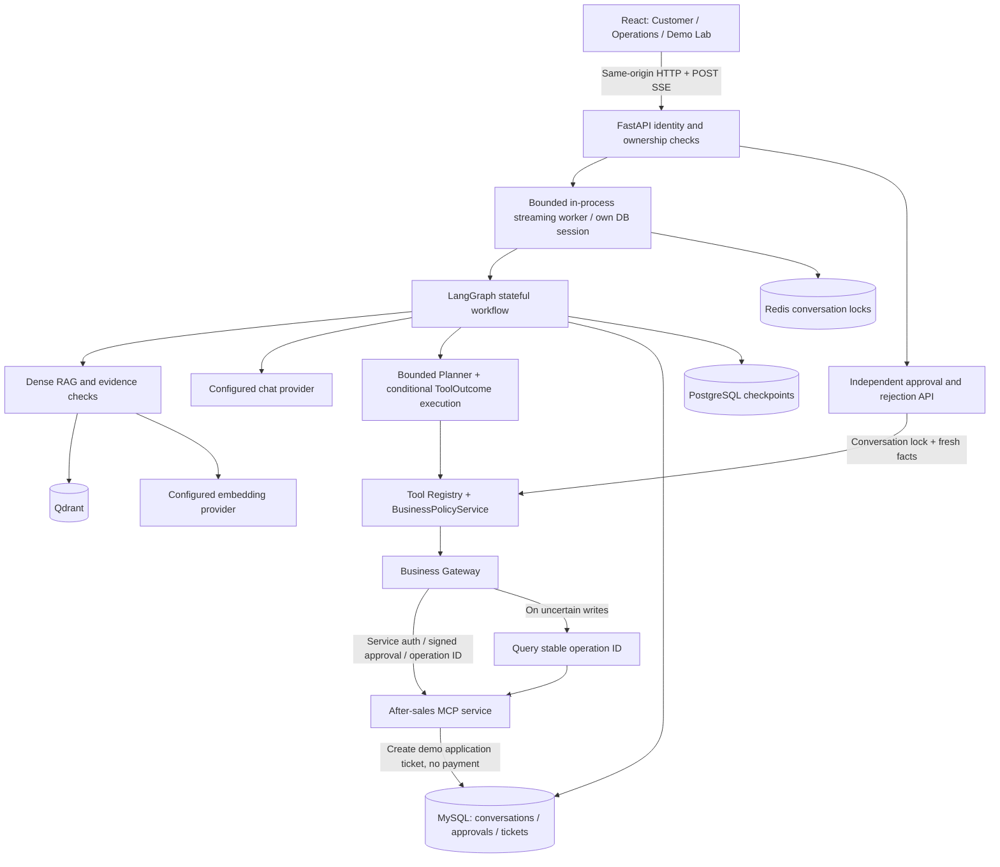

# Architecture

Browser events are an allowlist, not graph-state dumps. Nodes finish before their events are sent. Provider-native deltas are used for final tool-result synthesis; direct/cached/conditional answers are not artificially split. Confirmation-required is a paused workflow, not a completed refund.

The HTTP subscription and the Agent worker have separate lifetimes. Closing a tab detaches reception; the worker can finish and commit. Recovery reads the owned workspace. There is no persistent SSE event log and no durable cross-process task queue. Hard process termination can leave a run requiring reconciliation.

The three seeded orders are demonstrations of conservative business checks, not a complete legal refund policy or real merchant verification. The MCP service writes application tickets, never transfers funds. Dense retrieval is the default. Milvus, OpenSearch/hybrid retrieval, reranking, tracing and observability integrations remain optional.

Detailed implementation history: [V3 rules](../V3改造与验证说明.md), [SSE contract](../P4.2真实流式交互与验收.md).
